```{r}
#| label: setup
#| include: false

# ----------------------------------------------------------------------
# HOW TO ADJUST THIS DECK
#
# Leave a slide out:   add {visibility="hidden"} after its title, e.g.
#                      ## Calibration {visibility="hidden"}
#                      The slide still renders in the file but is skipped in the talk.
#                      To remove it for good, delete everything from its ## line to the next ## line.
#
# Swap in real results: every result slide starts from a small aggregated table, the kind you
#                      can export from DST (remember n < 5 suppression). Replace the tibble(...) or
#                      simulation code in the chunk with readRDS("your_file.rds"), keep the column
#                      names written in the comment, and delete the ::: {.sim-flag} block on that slide.
#
# Add a new result:    copy one of the three TEMPLATE slides at the end of "Preliminary findings"
#                      (figure from file, table from file, plot from an aggregated table), rename the
#                      title, point it at your file, delete {visibility="hidden"} and #| eval: false.
#
# Each result slide is self-contained, so deleting or reordering slides breaks nothing else.
# ----------------------------------------------------------------------

library(dplyr)
library(ggplot2)
library(kableExtra)
library(ggrepel)

# Colours: SDCA red, blue, amber (checked for colour-blind separation)
col_red   <- "#990032"
col_blue  <- "#1d6fa3"
col_amber <- "#c27a12"
col_pink  <- "#d9899f"

theme_wp2 <- theme_minimal(base_size = 26) +
  theme(
    panel.grid.minor = element_blank(),
    panel.grid.major = element_line(colour = "grey90"),
    axis.title = element_text(colour = "grey30"),
    legend.position = "top",
    legend.title = element_blank(),
    plot.title.position = "plot"
  )
theme_set(theme_wp2)

# ---- Table 1 from the DST export (results/table1_development_data.csv) ----
# Readable names for the variables. Add a line here if you add a variable to the export.
tab1_labels <- c(
  age                     = "Age, years",
  ethnicity               = "Region of origin (WHO)",
  highest_education_group = "Education",
  income_quartile         = "Income quartile",
  paritet_cat             = "Parity",
  bmi                     = "BMI, kg/m²",
  smoking                 = "Smoking",
  gdm_current             = "GDM, this pregnancy",
  gdm_previous            = "Previous GDM",
  pre_eclampsia_current   = "Pre-eclampsia, this pregnancy",
  pre_eclampsia_previous  = "Previous pre-eclampsia",
  hba1c_value             = "HbA1c, mmol/mol",
  hba1c_available         = "HbA1c available",
  gestational_age         = "Gestational age, days",
  macrosomic_baby         = "Macrosomia",
  weight_baby             = "Birth weight, g",
  length_baby             = "Birth length, cm",
  head_circumference      = "Head circumference, cm",
  c_section               = "Caesarean section",
  t2d_fu                  = "T2D in follow-up"
)
# Yes/no variables: show only this level, on the variable's own line
tab1_one_line <- c(gdm_previous = "1", pre_eclampsia_previous = "1", hba1c_available = "1",
                   macrosomic_baby = "1", c_section = "1", t2d_fu = "diabetes")
# Readable names for category levels
tab1_levels <- c(
  non_smoker = "Non-smoker", stopped_smoking_during_pregnancy = "Stopped in pregnancy",
  smoked_during_pregnancy = "Smoked in pregnancy", missing = "Missing",
  early = "Early", late = "Late", none = "None", normal = "Normal"
)

tab1_raw <- read.csv("table_figures/table1_development_data.csv", check.names = FALSE,
                     colClasses = "character")
names(tab1_raw) <- c("label", "missing", "value")
tab1_n <- gsub("\\*", "", names(read.csv("table_figures/table1_development_data.csv",
                                          check.names = FALSE, nrows = 1))[3])
is_var <- grepl("^__.*__$", tab1_raw$label)
var_name <- ifelse(is_var, gsub("__", "", tab1_raw$label), NA)
tab1_raw$var <- var_name[cummax(seq_along(var_name) * !is.na(var_name))]
tab1_raw$is_var <- is_var

# Make a kable for a set of variables, e.g. tab1_part(c("age", "bmi"))
tab1_part <- function(vars, font_size = 20) {
  rows <- list()
  for (v in vars) {
    d <- tab1_raw[tab1_raw$var == v, ]
    head_row <- d[d$is_var, ]
    lev <- d[!d$is_var, ]
    if (v %in% names(tab1_one_line)) {
      val <- lev$value[lev$label == tab1_one_line[[v]]]
      rows[[length(rows) + 1]] <- data.frame(Characteristic = tab1_labels[[v]],
        value = val, Missing = head_row$missing, level = FALSE)
    } else {
      rows[[length(rows) + 1]] <- data.frame(Characteristic = tab1_labels[[v]],
        value = ifelse(is.na(head_row$value) | head_row$value == "NA", "", head_row$value),
        Missing = head_row$missing, level = FALSE)
      if (nrow(lev) > 0) {
        lab <- ifelse(lev$label %in% names(tab1_levels), tab1_levels[lev$label], lev$label)
        rows[[length(rows) + 1]] <- data.frame(Characteristic = lab, value = lev$value,
                                               Missing = "", level = TRUE)
      }
    }
  }
  out <- do.call(rbind, rows)
  lvl <- which(out$level)
  names(out)[2] <- tab1_n
  kbl_wp2(out[, 1:3], font_size = font_size, align = "lrr", row.names = FALSE) |>
    add_indent(lvl) |>
    row_spec(which(!out$level), bold = TRUE) |>
    column_spec(2:3, extra_css = "white-space: nowrap;")
}

# Same table look as the EASD slides
kbl_wp2 <- function(x, font_size = 26, ...) {
  kbl(x, ...) |>
    kable_styling(bootstrap_options = c("striped", "condensed"),
                  font_size = font_size, full_width = FALSE)
}
```

# Background {background-color="#f0f0f0"}

## Why after childbirth? {.smaller}

::: columns
::: {.column width="50%"}
- Gestational diabetes (GDM) affects about **6% of deliveries** in Denmark and carries a **near tenfold higher risk** of later type 2 diabetes
- Danish GDM criteria use a **high threshold** and a **2-h glucose only**, so many women below the threshold are still at elevated risk
- Pregnancy and family formation are periods where women are **receptive to health messages**
:::

::: {.column width="50%"}
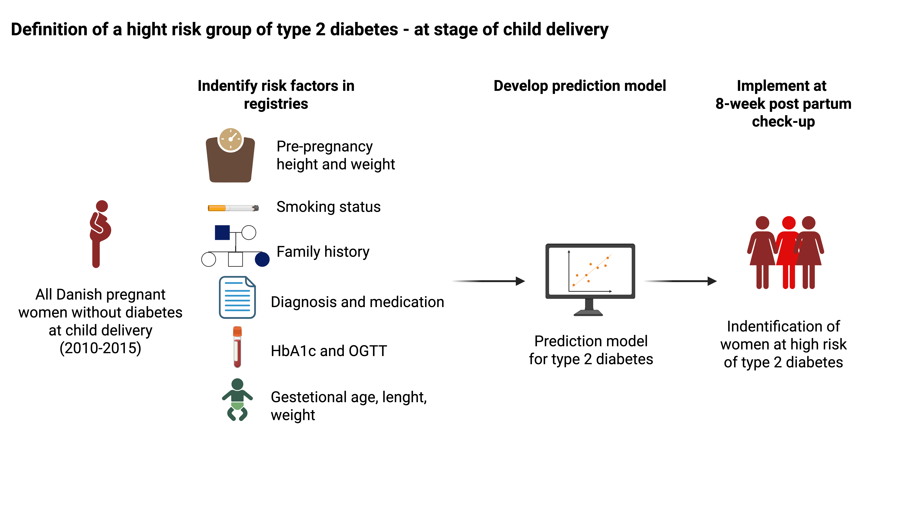
:::
:::

## Aim {.center}

::: box
Develop and validate a prediction model that identifies women at **high risk of type 2 diabetes** after giving birth
:::

::: fragment
**Long-term goal:** a clinically ready tool at the **8-week postpartum check-up** in general practice, so that high-risk women can be offered the intervention designed in **WP4**
:::

## Prediction model {.smaller}

- *Who* will develop type 2 diabetes?
- Any variable available at the index date may help, causal or not
- Judge the model by its **predicted risks**: are they accurate (calibration) and do they separate cases from non-cases (discrimination)?


::: notes
For the non-prediction people: we do not care why a predictor works, only that it improves risk estimates in new women.
:::

# Methods {background-color="#f0f0f0"}

Definition of population

## Study population

::: columns
::: {.column width="50%"}
**Women who:**

- gave birth at least once between **2010 and 2015**
- have no previous diagnosis of type 1 or type 2 diabetes at the index date
:::

::: {.column width="50%"}
::: fragment
**Exclusion:**

- Stillbirth in primiparous women (parity = 1)

**Linkage:** Danish nationwide registries at Statistics Denmark via pseudonymised CPR; the Medical Birth Register links mother, child and earlier pregnancies
:::
:::
:::

## Time window for prediction

::: timeline
::: {.tl-exp}
**Exploration**<br>2003-2009
:::
::: {.tl-train}
**Training**<br>2010-2014
:::
::: {.tl-test}
**Test**<br>2015
:::
::: {.tl-horizon}
**Prediction horizon**<br>2016-2025
:::
:::

- **Index date:** one week after delivery, so that all delivery data are registered
- **Outcome:** 10-year risk of registry-defined type 2 diabetes (follow-up to 31 Dec 2025)
- **Censoring:** emigration, death or end of follow-up

## Predictors at index date

### Before, during and at delivery

::: predictors
| Pre-pregnancy | During pregnancy | At delivery |
|:--|:--|:--|
| **Demographics**<br>[age, origin, education, income]{.pd} | **BMI**<br>[first antenatal visit]{.pd} | **Gestational age**<br>[preterm, spontaneous or induced]{.pd} |
| **Diagnoses**<br>[all ICD-10, 10 years before]{.pd} | **Smoking**<br>[first antenatal visit]{.pd} | **Newborn size**<br>[weight, length, macrosomia]{.pd} |
| **Specific diagnoses**<br>[PMOS, previous GDM, pre-eclampsia]{.pd} | **OGTT**<br>[performed; values below threshold]{.pd} | **Size for gestational age**<br>[SGA, LGA by sex]{.pd} |
| **Medication**<br>[all ATC, 10 years before]{.pd} | **HbA1c**<br>[early pregnancy]{.pd} | **Mode of delivery**<br>[vaginal, planned or emergency CS]{.pd} |
| **Laboratory**<br>[HbA1c, lipids, liver, kidney, CRP]{.pd} | **Gestational diabetes**<br>[early (< wk 20) or late (> wk 28)]{.pd} | **Complications**<br>[abruption, neonatal hypoglycaemia]{.pd} |
| **Family history**<br>[T2D and GDM in relatives]{.pd} | **Hypertensive disorders**<br>[pre-eclampsia or GH; early or late]{.pd} | **Plurality**<br>[singleton or multiple]{.pd} |
:::

## Data sources

### Nationwide registries at Statistics Denmark

```{r}
#| label: t-registries
registries <- tibble::tribble(
  ~Registry,                        ~Coverage,                     ~`Used for`,
  "Population register (BEF)",      "CPR 1968; BEF 1980",          "Age, origin, family links",
  "Education, income (UDDA, IND)",  "Annual from 1980",            "Socioeconomic position",
  "Patient Registry (LPR)",         "Outpatient from 1995",        "Diagnoses, GDM, delivery",
  "Medical Birth Register (MFR)",   "1973; BMI from 2003",         "Pregnancy, BMI, newborn",
  "Prescription Registry (LMDB)",   "From 1995",                   "All medication, OSDC",
  "Laboratory Results (RLRR)",      "Regional, Oct 2013-Jul 2015", "HbA1c, lipids, CRP, OGTT",
  "Health Service Registry (SSSY)", "SYSI 1990; SSSY 2006",        "Podiatry in OSDC"
)
kbl_wp2(registries, font_size = 26)
```

## Cohort and subcohorts for prediction model {.smaller}

### Main model and partial data

::: columns
::: {.column width="50%"}
**Full cohort**

All nationwide predictors for every index birth, **except laboratory measurements**
:::

::: {.column width="50%"}
**Subcohorts** by partly available data

::: fragment
- **Parity:** second and later births add data from previous pregnancies
:::
::: fragment
- **Prior HbA1c:** 10% of women in 2010, 25% in 2015; restricted to Central, North and Capital Regions
:::
::: fragment
- **Family linkage:** number of linkable relatives varies (e.g. recent immigrants have none)
:::
:::
:::

## Descriptive

## Trends in incidence type 2 diabetes

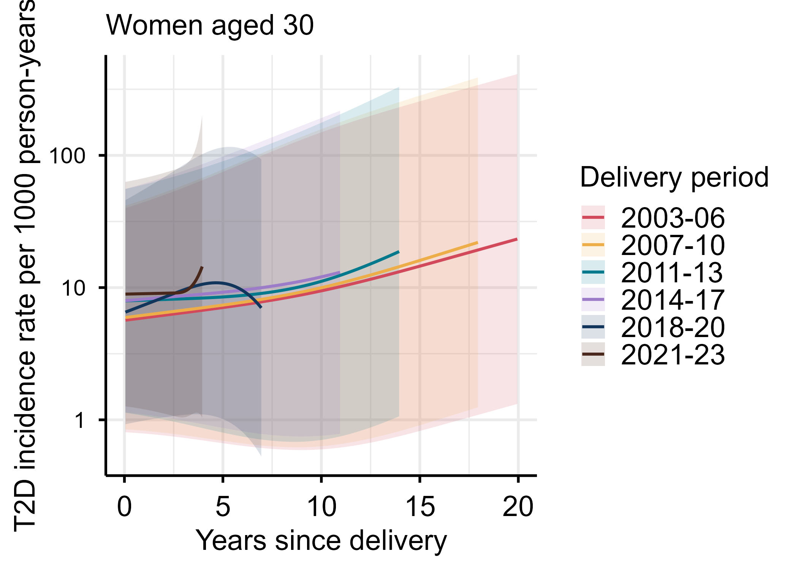{.r-stretch fig-align="center"}

## Trends in incidence type 2 diabetes by region

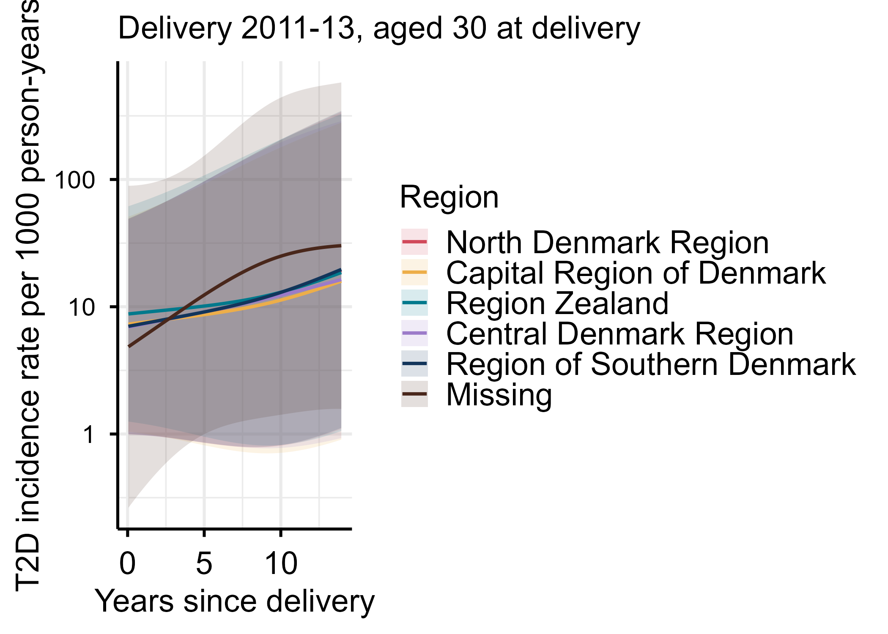{.r-stretch fig-align="center"}


## Define predictors

## The usual suspects

## Body mass index

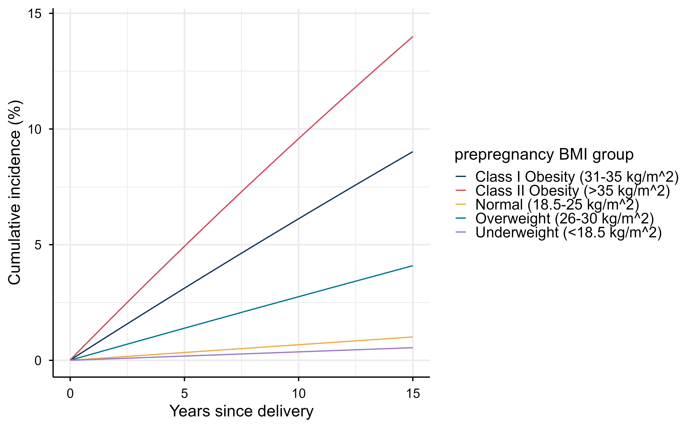{.r-stretch fig-align="center"}

## Trends in BMI distribution over calendar

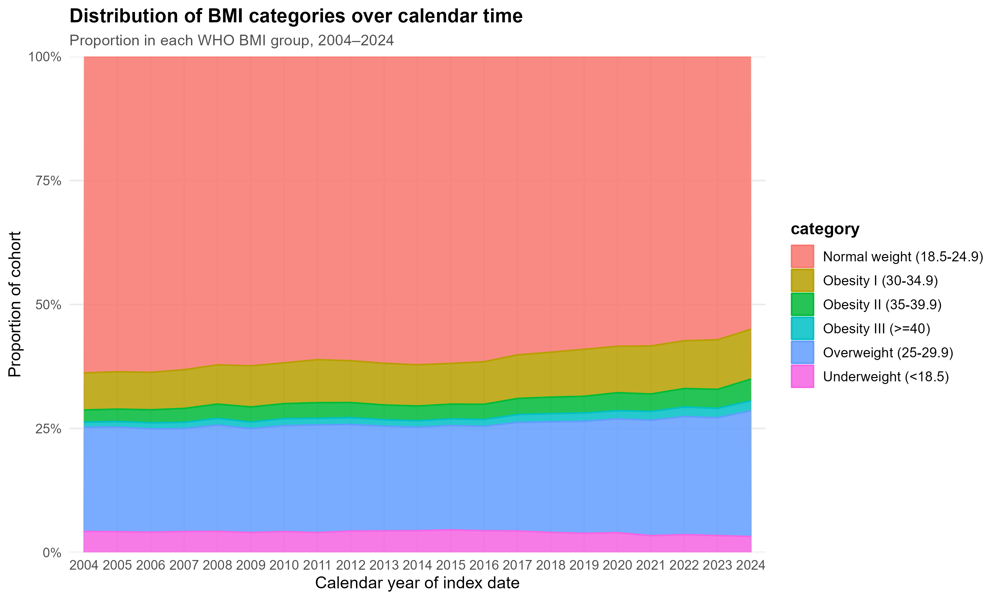{.r-stretch fig-align="center"}
## and by region..

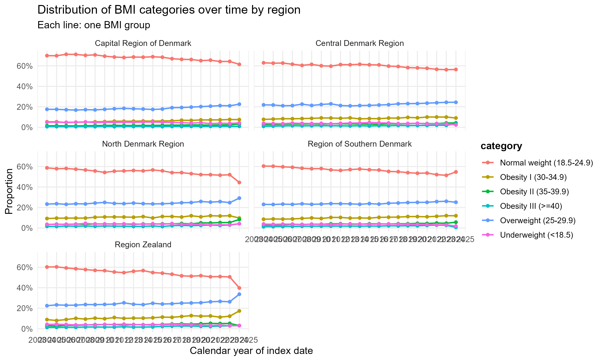{.r-stretch fig-align="center"}

## Education

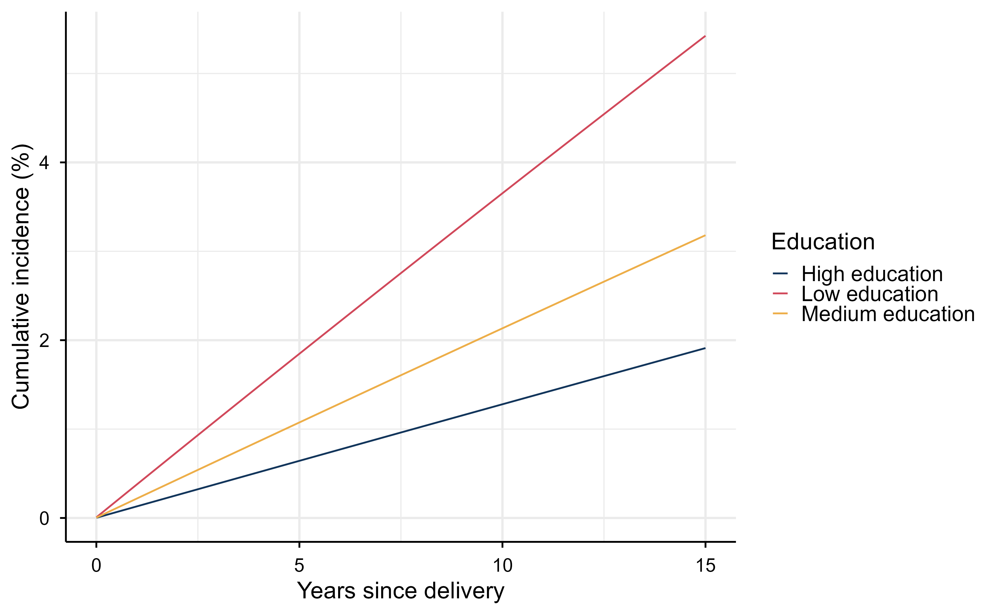{.r-stretch fig-align="center"}

## Ethnicity


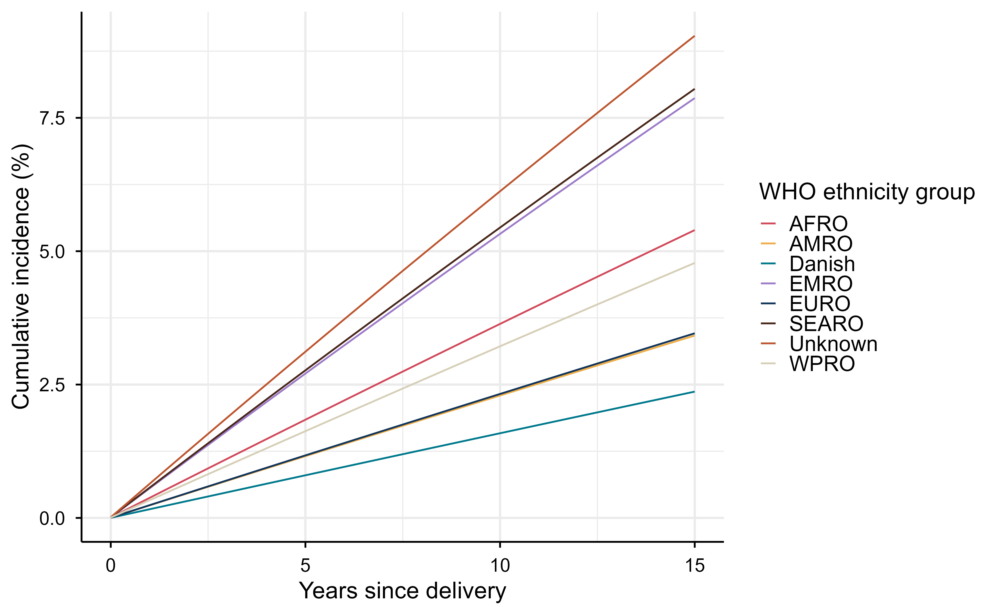{.r-stretch fig-align="center"}

## Trends in BMI distribution over calendar

{.r-stretch fig-align="center"}

{.r-stretch fig-align="center"}

## Trends in smoking distribution over calendar

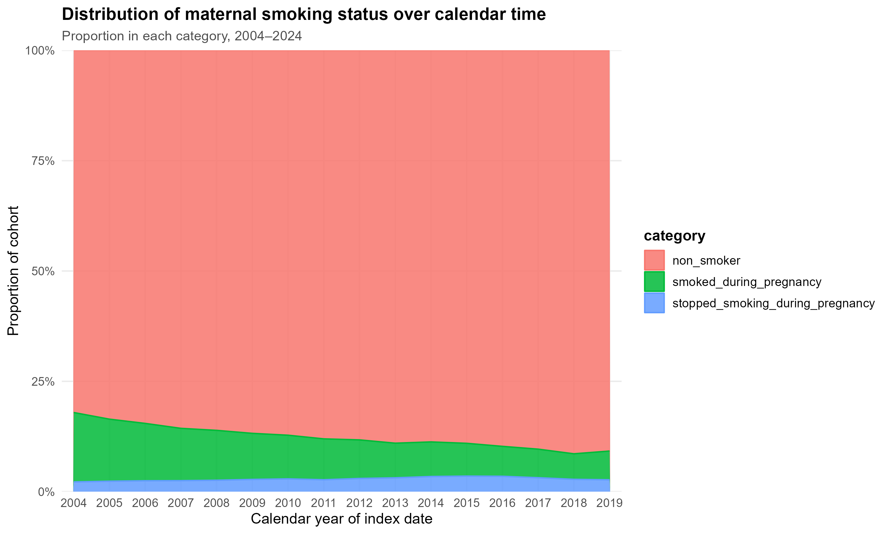{.r-stretch fig-align="center"}


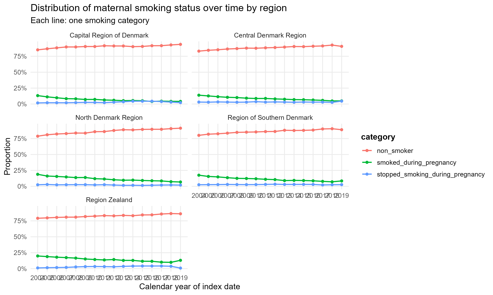{.r-stretch fig-align="center"}

## Selecting predictors in the exploration data

Exploration data: deliveries **2003-2009**, kept apart from model development

::: steps
::: step
**1. Screen**<br>Test every ICD-10 and ATC code (10-year history) against 10-year T2D risk. Manhattan plot by code group
:::
::: step
**2. Expert review**<br>SDCA and SDCC experts: is the signal biased? Collapse overlapping predictors (hypertension + antihypertensives)
:::
::: step
**3. Prevalence vs effect**<br>10-year risk given each remaining variable; plot prevalence against strength of association
:::
::: step
**4. Expert review**<br>Keep relevant predictors given prevalence and magnitude of risk
:::
:::

## Step 2: Model choice {.smaller}

### Choosing the statistical model

::: columns
::: {.column width="55%"}
- The exploration data go to the **team of prediction modellers**, who compete for the best performing model while sharing methods
- Candidate methods: **Cox**, **Poisson**, **LASSO**, **random forest**
- Combined in a **super learner** that picks the best model by cross-validated **Brier score**
:::

::: {.column width="45%"}
::: {.fragment .box}
**Brier score:** average squared difference between predicted risk and what happened (0 = perfect). Compare it with a model that gives every woman the same risk
:::
:::
:::

## Step 3: Partial data {.smaller}

### Handling partly available markers

**Developed in the full cohort**

1. Marker as a present/absent indicator, together with calendar time
2. Multiple imputation of markers available at baseline

**Developed in the subcohort**

3. Submodel restricted to complete cases

::: fragment
All three enter the super learner, which selects by cross-validated Brier score
:::

## HbA1c availability

### HbA1c in the 3 years before the index date, by region

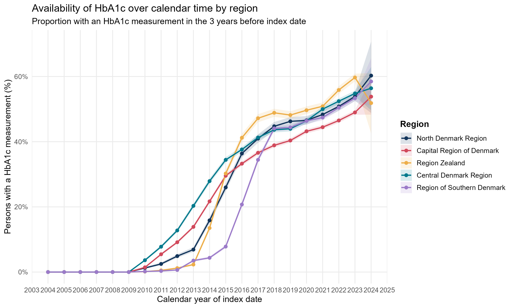{fig-align="center" .r-stretch}

## Validation {.smaller}

### Geographical and temporal test sets

::: columns
::: {.column width="50%"}
**Geographical**

Leave one region out of development and test there
:::

::: {.column width="50%"}
**Temporal**

Test on **2015** deliveries, closest to the 2027 population where the model will be used
:::
:::

::: fragment
**Performance:** Brier score, to emphasise individual calibration of risk

**Subgroups:** age group, parity, HbA1c present or absent at baseline
:::

## From model to WP4

### What WP4 receives

::: steps
::: step
**Final model**<br>Retrain the best model on 2010-2015 and export from DST
:::
::: step
**R Shiny app**<br>10-year T2D risk and expected 5-year HbA1c, delivered to WP4
:::
::: step
**Run on recent births**<br>Distribution of risk, most informative data, geographical clustering
:::
::: step
**WP4 focus group**<br>e.g. GPs who measure HbA1c routinely in pregnancy; women above a BMI threshold
:::
:::

# Preliminary findings {background-color="#f0f0f0"}

## Population: the mother

### Development data, mean (SD) or n (%)

::: columns
::: {.column width="50%"}
```{r}
#| label: t1-mother-a
tab1_part(c("age", "ethnicity", "highest_education_group"), font_size = 18)
```
:::
::: {.column width="50%"}
```{r}
#| label: t1-mother-b
tab1_part(c("income_quartile", "paritet_cat", "bmi", "smoking"), font_size = 18)
```
:::
:::

::: notes
Education is missing for 26%. Parity: 85% are parity 1 (check what the variable counts).
:::

## Pregnancy and birth

### Development data, mean (SD) or n (%)

::: columns
::: {.column width="50%"}
```{r}
#| label: t1-preg-a
tab1_part(c("gdm_current", "gdm_previous", "pre_eclampsia_current", "pre_eclampsia_previous"))
```
:::
::: {.column width="50%"}
```{r}
#| label: t1-preg-b
# c_section is left out: in the export 0 is coded as missing. Add "c_section" here once recoded.
tab1_part(c("hba1c_available", "hba1c_value", "gestational_age", "weight_baby",
            "length_baby", "macrosomic_baby", "t2d_fu"))
```
:::
:::


## Model performance

### First models in the test data

```{r}
#| label: t-score
# Export from DST: results/table_score_testdata.csv (columns model, AUC, Brier, IPA)
# Short names for the models, in the order of the rows in the file
model_names <- c("Basic", "Extended")

score <- read.csv("table_figures/table_score_testdata.csv")
pretty_vars <- function(x) {
  x <- gsub("\\+", ", ", x)
  x <- gsub("gdm_status", "GDM", x)
  x <- gsub("bmi", "BMI", x)
  x <- gsub("highest_education_group", "education", x)
  x <- gsub("pre_eclampsia_current", "pre-eclampsia", x)
  x <- gsub("weight_baby", "birth weight", x)
  x <- gsub("length_baby", "birth length", x)
  x <- gsub("gestational_age", "gestational age", x)
  x
}
null_brier <- mean(score$Brier / (1 - score$IPA))   # Brier of the model that gives everyone the same risk

score_tab <- data.frame(
  Model        = c("Null (same risk for all)", model_names),
  Predictors   = c("none", pretty_vars(score$model)),
  AUC          = c("0.50", sprintf("%.3f", score$AUC)),
  `Brier score` = sprintf("%.4f", c(null_brier, score$Brier)),
  IPA          = c("0%", sprintf("%.1f%%", 100 * score$IPA)),
  check.names  = FALSE
)
kbl_wp2(score_tab, font_size = 26, align = "llrrr") |>
  column_spec(2, width = "22em") |>
  column_spec(3:5, extra_css = "white-space: nowrap;")
```

## Discrimination

### ROC curves for the two models

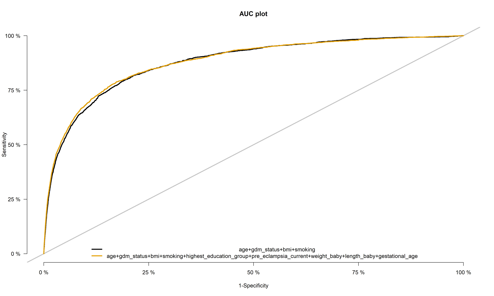{fig-align="center" .r-stretch}


## Calibration

### Predicted versus observed 10-year risk

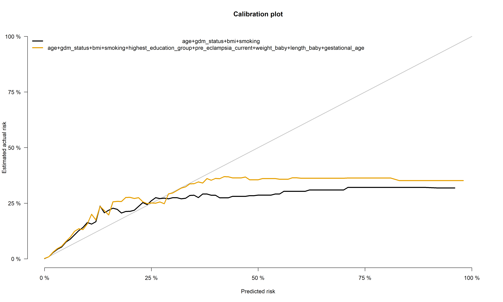{fig-align="center" .r-stretch}


## Reach for WP4

::: {.sim-flag}
SIMULATED EXAMPLE
:::

::: columns
::: {.column width="55%"}
```{r}
#| label: f-risk-dist
#| fig-width: 6
#| fig-height: 5.5
# Export from DST: number of women per bin of predicted 10-year risk (0.5%-point bins)
# Columns: risk_bin (lower edge), n
riskdist <- tibble(risk_bin = seq(0, 0.195, by = 0.005)) |>
  mutate(n = round(120000 * exp(-risk_bin / 0.012)))
cut_top10 <- 0.025   # predicted risk at the 90th percentile

ggplot(riskdist, aes(risk_bin + 0.0025, n, fill = risk_bin >= cut_top10)) +
  geom_col(width = 0.0045) +
  geom_vline(xintercept = cut_top10, linetype = "dashed", colour = "grey30") +
  annotate("text", x = cut_top10, y = max(riskdist$n) * 0.9, label = " Top 10%",
           hjust = 0, size = 8, colour = "grey20") +
  scale_fill_manual(values = c(col_pink, col_red), guide = "none") +
  scale_x_continuous(labels = scales::percent, limits = c(0, 0.10)) +
  scale_y_continuous(labels = scales::comma) +
  labs(x = "Predicted 10-year risk", y = "Women")
```
:::

::: {.column .pad-top width="45%"}
```{r}
#| label: t-capture
# Export from DST: performance at risk cut-offs in the test data
# Columns: Group, flagged, captured, ppv
capture <- tibble::tribble(
  ~`Highest risk`, ~`Cases captured`, ~`PPV`,
  "Top 5%",        "45%",             "13%",
  "Top 10%",       "60%",             "9%",
  "Top 20%",       "75%",             "6%"
)
kbl_wp2(capture, font_size = 26, align = "lrr")
```

::: small
**Cases captured:** share of all women who develop T2D within 10 years that are in the group

**PPV:** share of the group who develop T2D
:::
:::
:::


# Discussion {background-color="#f0f0f0"}

## Open questions

### For discussion today

::: {.discuss .small}
1. **Optimism:** bootstrap correction on top of the regional and temporal test sets?
2. **Repeated births:** women contribute several births; split folds and test set by woman
3. **Censoring:** IPCW for the Brier score; death as a competing risk
4. **HbA1c:** indicator with calendar time, imputation or subcohort model?
5. **Region of origin:** WHO regions or the grouping in Nielsen et al. (JCEM 2024)?
6. **Mode of delivery:** suggested categories of spontaneous vaginal, instrumental/assisted, planned c-section, and emergency c-section- issues with identifying where data comes from
7. **Parity:** currently handled categorically, extreme values>6 regarded as missing (0.6% of population)
8. **History from previous pregnancies:** (for parity>1)- potential subset cohorts
9. **GDM/Pre-Eclampsia:** Defined diagnostic window early/normal/late - clinically useful? 
10. **Newborn size:** SGA/LGA reference (Marsál 1996?); macrosomia at 4,000 or 4,500 g
11. **Explainability:** should WP4 see what drives a woman's risk?
:::

## Thank you {.center}

::: columns
::: {.column width="50%"}
This work is supported by **DP-NEXT**

Questions and input for the protocol are very welcome
:::

::: {.column width="50%"}
::: small
Co-authors of the protocol:

- Ulla Kampmann
- Daniel R. Witte
- Thomas Gerds
- Karoline Kragelund Nielsen
- Stine Byberg
:::
:::
:::
